# Expert Transplant (Project J'AI)

Training, testing and evaluation code for one question: **can a frozen Mixture-of-Experts layer from one pretrained language model replace the feed-forward network (FFN) of another, independently trained model, if only two small projection matrices per layer are trained?**

Gemma 3 1B (dense) is the host. In Stages 1 to 3 the donor is MobileMoE-M-Base and all 26 of Gemma's FFNs are replaced by its MoE blocks, each between two trainable projections. Stage 4 changes the architecture: MobileMoE-S-Base's 20 MoE blocks replace 20 of Gemma's FFNs at the same relative depth, and Gemma keeps its own FFN in the other 6 layers. Both models always stay frozen. Everything trains and runs on a MacBook Air M5 (16 GB, PyTorch MPS, bf16), with packages installed by [uv](https://docs.astral.sh/uv/).

> **Objective.** Project J'AI started from a plain question: if I remove the FFNs of one model and put the MoE layers of a different model in their place, will the result still work as a language model? I just wanted to know whether it works or not. It looks like it does. The trained projection matrices in each slot (W_in and W_out, the transformation layer between the two hidden sizes) learn to translate between the two models, so that one model's embeddings and attention can communicate with another model's MoE experts.

| Contents | |
| --- | --- |
| [1. What is the experiment?](#1-what-is-the-experiment-project-jai) | The question, the hypotheses, the two models, the results |
| [2. Architecture](#2-architecture) | The hybrid end to end, one transplanted layer, the MoE block, training and metrics, with figures and equations |
| [3. Stage 1: experiment and results](#3-stage-1-experiment-and-results) | 1M tokens: ridge init, local matching, end to end |
| [4. Stage 2: experiment and results](#4-stage-2-experiment-and-results) | 5M tokens end to end: held-out curve, routing, questions and answers |
| [5. Stage 3: experiment and results](#5-stage-3-experiment-and-results) | 15M more tokens on Stage 2, to 20M: the learning-rate restart, the power law, questions and answers |
| [6. Stage 4: a different architecture](#6-stage-4-a-different-architecture-partial-transplant-with-mobilemoe-s) | MobileMoE-S in 20 of 26 layers, 6 Gemma FFNs kept: architecture and equations, matched-token results |
| [Run it](#run-it) | Setup, commands, repository layout; the full guide is [docs/usage.md](docs/usage.md) |

---

## 1. What is the experiment? (Project J'AI)

A dense transformer stores much of what it knows in its FFNs. A Mixture of Experts replaces one large FFN with many small experts and a router that picks a few per token. **Project J'AI** tests whether the MoE layers of one pretrained model are functionally portable: can they stand in for the FFNs of a model that never trained with them, if a learned transformation on each side translates between the two models' hidden states?

The transformation is a pair of linear maps per layer: **W_in** maps Gemma's hidden state into MobileMoE's space (1152 → 1024) and **W_out** maps the MoE block's output back (1024 → 1152). They are two independent matrices, not one matrix and its transpose. Nothing else trains.

### Hypotheses

The project tests two hypotheses:

| ID | Hypothesis | Measured by | Null result |
| --- | --- | --- | --- |
| H1 | With all 26 of Gemma's FFNs replaced by MobileMoE's MoE blocks, the hybrid recovers most of what Gemma loses when its FFNs are deleted | `GR_CE` on the held-out mix, with the CE gap to Gemma, the perplexity ratio and next-token accuracy beside it | `GR_CE` near 0: no better than Gemma with its FFNs deleted |
| H2 | Inside the hybrid, routing stays diverse and agrees with MobileMoE's own routing above chance, on positions where both tokenizers align | Routing health on every evaluation; agreement with `eval --routing-agreement` | Router collapse (normalized entropy below 0.7), or chance-level agreement (0.039) |

### The models

| Role | Hugging Face id | Layers × width | FFN or experts | Tokenizer | Parameters | License |
| --- | --- | --- | --- | --- | --- | --- |
| A (host, dense) | [`google/gemma-3-1b-pt`](https://huggingface.co/google/gemma-3-1b-pt) | 26 × 1152 | GeGLU, hidden 6912 | Gemma 3, 262,144 | 1.0B | Gemma Terms of Use (gated) |
| B (donor, Stages 1-3) | [`facebook/MobileMoE-M-Base`](https://huggingface.co/facebook/MobileMoE-M-Base) | 26 × 1024 | 60 routed (hidden 512), top-4 sigmoid, + 1 shared (hidden 2048) | Llama 3, 128,256 | 2.8B total, 528M active | FAIR Noncommercial Research (gated) |
| B′ (donor, Stage 4) | [`facebook/MobileMoE-S-Base`](https://huggingface.co/facebook/MobileMoE-S-Base) | 20 × 768 | 60 routed (hidden 384), top-4 sigmoid, + 1 shared (hidden 1536) | Llama 3, 128,256 | 1.3B total, 272M active | FAIR Noncommercial Research (gated separately) |

In Stages 1 to 3 both models have 26 layers, so Gemma layer i borrows MobileMoE-M layer i; Stage 4's layer map is in Section 6. Widths, tokenizers and FFN designs all differ. Gemma 3's training data was never released, so the training data is MobileMoE-M-Base's open pre-training mix (Table B.1 of [the MobileMoE paper](https://arxiv.org/abs/2605.27358): web 62%, math 11.6%, code 10%, knowledge 10%, science 6.4%), streamed from Hugging Face; held-out documents of the same mix, WikiText-103 and C4 are used only for evaluation.

### Results

| Validation mix, 250k held-out tokens | Gemma 3 1B | All 26 FFNs deleted | Stage 1 (1M, all 26, M) | Stage 2 (5M, all 26, M) | Stage 3 (20M, all 26, M) | Stage 4 (15M, 20 of 26, S) |
| --- | --- | --- | --- | --- | --- | --- |
| Trainable parameters | – | – | 61.3M | 61.3M | 61.3M | **35.4M** |
| Perplexity | 10.25 | 4,957,444 | 71.28 (6.95 ×) | 33.96 (3.31 ×) | 23.50 (2.29 ×) | **23.17 (2.26 ×)** |
| CE gap to Gemma (nats), mix / WikiText-103 / C4 | 0 | 13.09 / 13.08 / 12.31 | 1.94 / 2.50 / 2.08 | 1.20 / 1.79 / 1.49 | 0.83 / 1.41 / 1.15 | **0.82 / 1.34 / 1.10** |
| `GR_CE` (all-26-deleted floor) | 1 | 0 | 0.852 | 0.909 | 0.937 | **0.938** |
| Next-token accuracy | 52.6% | 0.1% | 31.0% | 38.5% | 42.5% | **42.5%** |
| Lowest routing entropy (alarm 0.7) | – | – | 0.856 | 0.829 | 0.806 | 0.724 |
| Fact recovery on 30 basic questions | 100% | 0% | 65% | 80% | 89% | **89%** |
| Questions answered correctly | 28 / 30 | 0 / 30 | 1 / 30 | 1 / 30 | 6 / 30 | **10 / 30** |
| Training speed on the M5 | – | – | 119 tok/s | 131 tok/s | 165-175 tok/s | **326 tok/s** |

M = MobileMoE-M-Base, S = MobileMoE-S-Base. In short: the transplant works as a language model, and it keeps improving with tokens, slowly (each doubling removes about 17% of the CE gap on the training mix, 12% on unlike text). Stage 4's partial transplant matches Stage 3 with 25% fewer tokens, 42% fewer trained parameters and a much weaker donor, and recalls facts as well: a sign that the recovered quality may not come mainly from the donor's own knowledge. No random-expert control was run, so this is not settled.

---

## 2. Architecture

This section describes the hybrid of Stages 1 to 3 (all 26 layers, MobileMoE-M); Stage 4 keeps the same layer design in 20 layers with a smaller donor, and its architecture and equations are in [Section 6](#6-stage-4-a-different-architecture-partial-transplant-with-mobilemoe-s). Colour code in every figure: **green** is trainable (W_in, W_out), **orange** is frozen MobileMoE, every other colour is frozen Gemma 3 1B, **grey dashed** is removed from the forward pass. The equation cards in [`docs/figures/equations/`](docs/figures/equations) carry the same equations as images; [docs/architecture.md](docs/architecture.md) has every symbol and derivation.

### 2.1 The hybrid, end to end


$$
X^{(0)} = \sqrt{1152}\,E_A[t], \qquad X^{(l)} = \mathrm{Layer}^{\mathrm{hyb}}_l\big(X^{(l-1)}\big), \qquad P = \mathrm{softmax}\big(N_f(X^{(26)})\,E_A^{\top}\big)
$$

Embeddings, attention, norms and the LM head stay Gemma's and stay frozen. MobileMoE contributes only its pre-MoE norms, routers and experts; its attention, embeddings and head are never loaded onto the GPU.

### 2.2 One transplanted layer


Gemma 3 wraps each FFN in a sandwich of norms, $N_A$ before it and $P_A$ after it:

$$
h = X + P_{\mathrm{att}}\big(\mathrm{Attn}(N_{\mathrm{in}}(X))\big), \qquad X' = h + P_A\big(\mathrm{FFN}_A(N_A(h))\big)
$$

The transplant keeps the sandwich and replaces only the FFN slot (`layer.mlp`):

$$
h^{\mathrm{out}}_t = h_t + P_A\Big(W_{out}\;\mathrm{MoE}_B\big(N_B(W_{in}\,x_t)\big)\Big), \qquad x_t = N_A(h_t) \in \mathbb{R}^{1152}
$$

Read it right to left: translate Gemma's state into MobileMoE's coordinates, let MobileMoE's norm $N_B$ and experts work there, translate back. An RMSNorm follows each projection ($N_B$ after $W_{in}$, $P_A$ after $W_{out}$), and RMSNorm ignores scale, so only the direction of each projection's output reaches the next stage:

$$
N(z) = \frac{z}{\sqrt{\frac{1}{d}\sum_c z_c^2 + \epsilon}} \odot \gamma, \qquad N_B(\alpha W_{in}x_t) \approx N_B(W_{in}x_t), \qquad P_A(\alpha W_{out}m_t) \approx P_A(W_{out}m_t)
$$

In code this is `ReplaceFFN` in [`src/transplant/models/surgery.py`](src/transplant/models/surgery.py). It also keeps Gemma's own FFN, frozen, for two other modes on the same weights: `original` (the intact Gemma, used as the KL teacher) and `zero` (Gemma with the FFN deleted, the floor of every metric).

### 2.3 Inside the borrowed MoE block


$$
\hat u_t = N_B(u_t), \qquad s_t = \sigma(W_r\,\hat u_t) \in (0,1)^{60}, \qquad \mathcal{T}_t = \mathrm{TopK}(s_t + b,\ 4), \qquad g_{t,e} = 2.5\,\frac{s_{t,e}}{\sum_{e' \in \mathcal{T}_t} s_{t,e'}}
$$

$$
m_t = S(\hat u_t) + \sum_{e \in \mathcal{T}_t} g_{t,e}\,E_e(\hat u_t)
$$

Each of the 60 experts gets an independent sigmoid score; a fixed per-expert bias $b$ decides which four are selected but not their weights; the chosen four are normalized and scaled to sum to 2.5; the shared expert $S$ is always on. Routing is dropless: every expert runs on exactly the tokens routed to it. The router is frozen, so **W_in alone decides which experts a token reaches**; the routing-health metrics watch for collapse. On the Apple GPU the block runs through `bucketed_moe_forward` (same arithmetic, expert groups padded to a few fixed sizes, one GPU sync per layer).

### 2.4 Counting parameters

| Quantity | Formula | Value |
| --- | --- | --- |
| Trainable, per layer | $2 \cdot 1152 \cdot 1024$ | 2,359,296 |
| Trainable, all 26 layers | × 26 | **61,341,696** |
| MoE block, per layer (frozen) | $60 \cdot 3 \cdot 1024 \cdot 512 + 3 \cdot 1024 \cdot 2048 + 60 \cdot 1024$ | 100.7M |
| MoE active per token, per layer | 4 routed + shared + router | 12,644,352 |
| Gemma FFN, per layer (removed from the forward pass) | $3 \cdot 1152 \cdot 6912$ | 23,887,872 |
| Active per token, all 26 layers replaced | $999{,}885{,}952 - 26 \cdot 8{,}884{,}224$ | about 0.77B (Gemma: 1.00B) |

### 2.5 Training: ridge init, then local matching, then end to end


**Ridge initialization.** Gemma and MobileMoE read the same calibration text with their own tokenizers; only positions where both end a token at the same character are paired (90.2% of Gemma's tokens). $W_{in}$ maps Gemma's $N_A(h)$ to MobileMoE's own MoE input at the same layer (RMS-normalized per token); $W_{out}$ then maps the MoE output to Gemma's own FFN output. $X^\top X$ and $X^\top Y$ are accumulated in fp64, so no activations are stored; $\lambda$ is chosen per layer on held-out batches.

$$
\hat W = (X^{\top}X + \lambda I)^{-1}X^{\top}Y, \qquad W_{in} = \hat W^{\top}
$$

**Local matching.** Each layer learns, on its own, to imitate the FFN it replaced; one pass of the original Gemma supplies inputs and targets for all 26 layers. Predicting zero, which is what a deleted FFN does, scores exactly 1:

$$
\mathcal{L}_1 = \frac{\sum_t \Vert \hat y_t - y_t\Vert^2}{\sum_t \Vert y_t\Vert^2}, \qquad \hat y_t = W_{out}\,\mathrm{MoE}_B\big(N_B(W_{in}x_t)\big), \qquad y_t = \mathrm{FFN}_A(x_t)
$$

**End to end.** Next-token cross-entropy through Gemma's head, plus a KL term to the original Gemma (the same weights with the transplants switched off):

$$
\mathcal{L}_2 = \mathrm{CE}(y, p_{hyb}) + \beta\,\mathrm{KL}(p_A \Vert p_{hyb}), \qquad \beta = 1
$$

Gemma's 262,144-token vocabulary makes the logits of one 1,024-token sequence 1.07 GB in fp32, so CE and KL are computed 256 positions at a time with a hand-written backward pass ($\partial L/\partial z = (g_{CE} + g_{KL})\,\mathrm{softmax}(z) - g_{CE}\,\mathrm{onehot}(y) - g_{KL}\,p_A$, recomputed per chunk). Right-padded batches run without an attention mask: on Apple GPUs a mask beyond Gemma's 512-token sliding window produces NaN, and both models are causal, so padding cannot reach the text.

| Setting | Local matching | End to end |
| --- | --- | --- |
| Optimizer | AdamW, betas (0.9, 0.95), eps 1e-8 | same |
| Learning rate, schedule | 1e-3, constant after warmup | 3e-4, cosine to 10%, 2% warmup |
| Weight decay, clipping | 0, 1.0 per layer | 0.01, 1.0 global |
| Tokens per optimizer step | 8,192 | 16,384 (16 sequences of 1,024) |
| Precision | Gemma and MobileMoE in bf16, projections in fp32 | same |

### 2.6 Metrics

$$
\mathrm{GR}_{\mathrm{CE}} = \frac{\mathrm{CE}_{\mathrm{ablated}} - \mathrm{CE}_{\mathrm{hybrid}}}{\mathrm{CE}_{\mathrm{ablated}} - \mathrm{CE}_{A}}, \qquad \text{CE gap} = \mathrm{CE}_{\mathrm{hybrid}} - \mathrm{CE}_{A}, \qquad \text{ratio} = \frac{\mathrm{ppl}_{\mathrm{hybrid}}}{\mathrm{ppl}_A}
$$

$$
\tilde H = -\frac{1}{\log 60}\sum_{e} f_e \log f_e \ \ge\ 0.7, \qquad \text{fact recovery} = \frac{\ell_{\mathrm{hybrid}} - \ell_{\mathrm{no\,FFN}}}{\ell_{A} - \ell_{\mathrm{no\,FFN}}}
$$

`GR_CE` places the hybrid between "all FFNs deleted" (0) and Gemma (1) in loss space. Deleting all 26 FFNs sends perplexity to about 5 million, so `GR_CE` is generous; the CE gap, the perplexity ratio and next-token accuracy are reported beside it. $\tilde H$ is the normalized entropy of expert load per layer ($f_e$: expert $e$'s share of the top-4 assignments). Fact recovery does for questions what `GR_CE` does for text, on $\ell$, the mean log-probability per token of the right fact after the reference sentence's opening ("The capital of France is" → "Paris").

---

## 3. Stage 1: experiment and results

**Goal:** show that the whole pipeline runs on the M5 with all 26 FFNs replaced, that the losses fall and that nothing turns NaN. Its quality numbers are a sanity check, not the result.

| Setting | Stage 1 |
| --- | --- |
| Config | `configs/stages/stage1_test.yaml` (run folder `runs/stage1_test`) |
| Recipe | ridge init (400 calibration documents, 211,601 aligned positions) → local matching → end to end |
| Tokens | 983,040 in total: 245,760 local matching (30 steps), 737,280 end to end (45 steps) |
| Speed, memory | 323 tokens/s local matching, 119 tokens/s end to end; peak 10.8 GB of 16 GB |
| Compute | about 3 hours: ridge 22 min, local matching 13 min, end to end 97 min, evaluations 43 min |

### Ridge and local matching

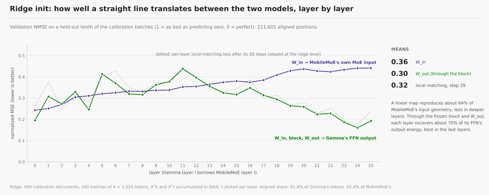

Before any gradient step, a linear map reproduces MobileMoE's MoE input with a mean validation NMSE of 0.36 (worse in deeper layers), and the full chain W_in → block → W_out reproduces Gemma's FFN output with 0.30 (best in the last layers). Local matching then ran 30 steps and stayed at the ridge level (mean loss 0.313 → 0.316). Each layer alone is a decent imitation, but 26 of them in a row compound their errors:

| Held-out mix, 99k tokens | Hybrid perplexity | × Gemma | `GR_CE` | Next-token accuracy |
| --- | --- | --- | --- | --- |
| After ridge + local matching | 1,562 | 154 | 0.623 | 8.0% |
| End-to-end step 20 | 104.6 | 10.3 | 0.825 | 27.9% |
| End-to-end step 40 | 77.2 | 7.6 | 0.848 | 30.0% |

End to end did the work: training CE 6.85 → 3.93, KL to Gemma 4.50 → 1.94 in 45 steps.

### Final evaluation (250k tokens per set)

| Set | Gemma ppl | All FFNs deleted | Hybrid ppl | Hybrid ÷ Gemma | CE gap (nats) | `GR_CE` | Accuracy, Gemma → hybrid |
| --- | --- | --- | --- | --- | --- | --- | --- |
| Validation mix | 10.25 | 4,957,444 | 71.28 | 6.95 | 1.94 | 0.852 | 52.6% → 31.0% |
| WikiText-103 | 11.84 | 5,660,224 | 144.57 | 12.21 | 2.50 | 0.809 | 49.5% → 23.2% |
| C4 validation | 16.19 | 3,609,581 | 129.13 | 7.98 | 2.08 | 0.831 | 44.4% → 23.2% |

Routing: lowest normalized entropy over the 26 layers 0.856 (alarm 0.7), 91 dead experts of 1,560.

**Samples** (greedy, 40 tokens): fluent fragments without facts that fall into loops. "The capital of France is the first to the world. The world is the first to the world…"; "Photosynthesis is the process by which the photos are the images…".

**Questions** (30 basic questions, one-sentence answers, `transplant ask`): 1 of 30 correct, fact log-probability −5.33 per token (Gemma −0.23, FFNs deleted −14.81): 65% fact recovery. 11 of 30 replies copied a few-shot example or the question.

### What Stage 1 showed

- **The pipeline works** on the M5 with all 26 FFNs replaced: peak 10.8 GB, no NaN, every loss falling, routing healthy.
- **`GR_CE` passed the proposed 0.5 bar after 1M tokens, which says little.** With the FFNs deleted, perplexity is about 5 million, so even a weak hybrid scores high. The CE gap (1.94 nats), the perplexity ratio (6.95 ×) and accuracy (31% against 53%) are the numbers to follow.
- **Local matching added nothing over ridge**, so Stage 2 gives every token to end-to-end training.

---

## 4. Stage 2: experiment and results

**Goal:** the first real answer to H1, with 5M tokens of end-to-end training.

| Setting | Stage 2 |
| --- | --- |
| Config | `configs/stages/stage2_full.yaml` + `configs/stages/stage2_5m.yaml` (run folder `runs/stage2_5m`) |
| Recipe | Stage 1's ridge init reused (`runs/stage1_test/init.pt`), no local matching, **end to end only** |
| Tokens | 4,997,120: 305 steps of 16,384, each token read once |
| Evaluation | 100k held-out tokens every 50 steps; 250k tokens per set at the end (as in Stage 1, so the numbers compare directly) |
| Speed, memory | 131 tokens/s, peak 9.8 GB |
| Compute | about 10 hours of training |

### The held-out curve

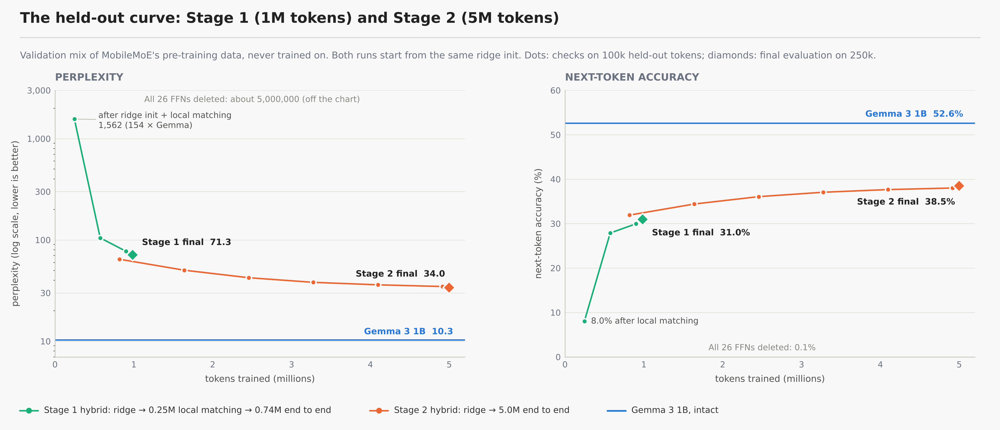

| Step | Tokens | Perplexity | × Gemma | `GR_CE` | Accuracy (Gemma 52.5%) |
| --- | --- | --- | --- | --- | --- |
| 50 | 0.82M | 64.44 | 6.37 | 0.861 | 31.9% |
| 100 | 1.64M | 50.26 | 4.97 | 0.880 | 34.4% |
| 150 | 2.46M | 42.35 | 4.19 | 0.893 | 36.1% |
| 200 | 3.28M | 38.12 | 3.77 | 0.901 | 37.1% |
| 250 | 4.10M | 36.05 | 3.56 | 0.905 | 37.7% |
| 300 | 4.92M | 34.68 | 3.43 | 0.908 | 38.0% |

Every check improved on the last, each by less. The CE gap fits roughly $\text{gap} \propto \text{tokens}^{-0.23}$: each doubling of tokens removes about 15% of it (rough forecast on the mix: perplexity about 28 at 10M tokens, about 24 at 20M).

### Final evaluation (250k tokens per set)

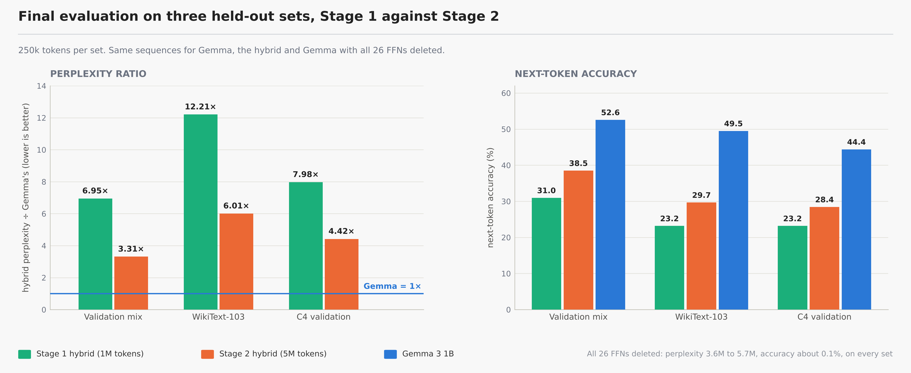

| Set | Gemma ppl | Hybrid ppl, Stage 1 → 2 | Hybrid ÷ Gemma | CE gap (nats), Stage 1 → 2 | `GR_CE`, Stage 1 → 2 | Hybrid accuracy, Stage 1 → 2 (Gemma) |
| --- | --- | --- | --- | --- | --- | --- |
| Validation mix | 10.25 | 71.28 → **33.96** | 6.95 → **3.31** | 1.94 → **1.20** (−38%) | 0.852 → **0.909** | 31.0% → **38.5%** (52.6%) |
| WikiText-103 | 11.84 | 144.57 → **71.18** | 12.21 → **6.01** | 2.50 → **1.79** (−28%) | 0.809 → **0.863** | 23.2% → **29.7%** (49.5%) |
| C4 validation | 16.19 | 129.13 → **71.57** | 7.98 → **4.42** | 2.08 → **1.49** (−28%) | 0.831 → **0.879** | 23.2% → **28.4%** (44.4%) |

All 26 FFNs deleted: perplexity 3.6M to 5.7M and next-token accuracy at most 0.2% on every set.

### Routing

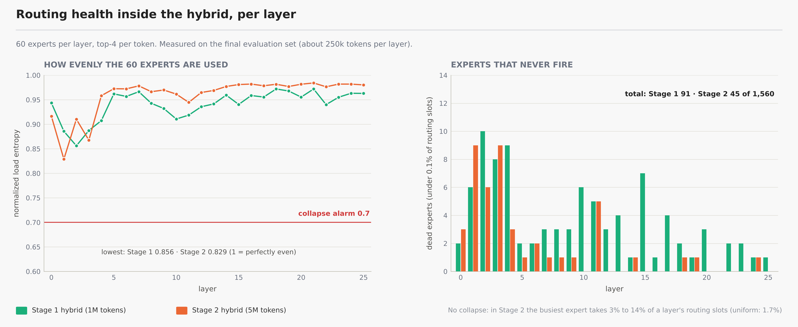

No collapse. Dead experts halved (91 → 45 of 1,560; 30 of them in layers 0 to 4) and the mean normalized entropy over the 26 layers rose from 0.940 to 0.959. The weakest layer is layer 1 at 0.829 (Stage 1's weakest: layer 2 at 0.856; alarm 0.7), where the busiest expert takes 14% of the routing slots (layer 3: 10%; every other layer 3% to 8%; uniform: 1.7%).

### Questions and answers

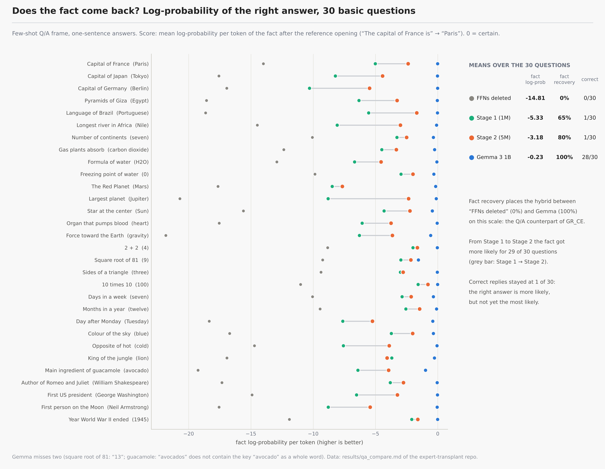

| Model | Tokens trained | Correct | Fact log-prob | Fact recovery | Sentence log-prob | Copied an example or the question |
| --- | --- | --- | --- | --- | --- | --- |
| Gemma, all 26 FFNs deleted | – | 0/30 | −14.81 | 0% | −12.91 | 0/30 |
| Hybrid, Stage 1 | 0.98M | 1/30 | −5.33 | 65% | −2.29 | 11/30 |
| Hybrid, Stage 2 | 5.00M | 1/30 | **−3.18** | **80%** | **−1.22** | **0/30** |
| Gemma 3 1B | – | 28/30 | −0.23 | 100% | −0.28 | 0/30 |

From Stage 1 to Stage 2 the right fact became more likely for 29 of 30 questions and whole-reply copying stopped (a few replies still splice in pieces of the examples), but the replies keep the format and the type of answer, not the value: "The capital of France is France.", "Water freezes at 100 degrees Celsius.", "A triangle has two sides.", "The World War II ended in 1999." The single hit in each stage is weak evidence: Stage 1's is a garbled echo that contains "sun", Stage 2's is "The sky is a blue sky." Full table: [results/qa_compare.md](results/qa_compare.md).

**Samples** (greedy, 40 tokens): grammatical and on topic, still without facts. "The capital of France is a country of the French, and the French is a country of the French…"; "In 1969, the first humans to walk on the Moon were the first to walk on the moon…". Gemma's continuations carry the facts ("2x", "Neil Armstrong and Buzz Aldrin", a working `fibonacci`).

### What Stage 2 showed

- **H1, as a language model: yes.** 91% of the CE gap between "FFNs deleted" and Gemma is recovered on the mix, the perplexity ratio roughly halved on all three sets, and perplexity, CE gap and accuracy improved with tokens on every set. The CE gap (1.20 nats, 3.31 × Gemma's perplexity) is still large.
- **H2, routing health: yes.** No layer near collapse; dead experts halved and mean entropy rose, though the weakest layer (layer 1, 0.829) is lower than Stage 1's weakest. Agreement with MobileMoE's own routing was not measured.
- **Fluency transfers much faster than knowledge.** Gemma's untouched attention handles format, copying and the type of the answer; the lookup from subject to fact, which a dense model keeps mostly in its FFNs, has not come back.
- **Not answered:** how much of the recovery comes from MobileMoE's pretrained experts rather than from 61M trainable parameters around any MoE; no random-expert control was run.

---

## 5. Stage 3: experiment and results

**Goal:** find out what more tokens buy. Stage 3 continues Stage 2's projections and Stage 2's data stream for 15M more tokens, so no token is read twice, and evaluates exactly as Stages 1 and 2 did.

| Setting | Stage 3 |
| --- | --- |
| Config | `runs/stage2_5m/config.yaml` + `configs/stages/stage3_20m.yaml` (run folder `runs/stage3_20m`), started with `bash scripts/stage3_run.sh` |
| Recipe | Starts from Stage 2's final projections (`run.extend_from`); end to end only, CE + 1.0 · KL to Gemma; fresh AdamW state and a new cosine schedule from 3e-4 with 2% warmup |
| Tokens | 14,991,360 in this run (915 steps of 16,384), **19,988,480 in total** |
| Speed check | micro-batch 1 × 16: 97 tok/s; **2 × 8: 148 tok/s (chosen)**; 4 × 4: 120 tok/s at 12.02 GB, over the 11.84 GB limit |
| Speed, memory | 165-175 tok/s; peak 10.97 GB |
| Compute | about 23.5 hours of training for the 15M tokens |

An extension restarts the learning rate from the peak:

$$
\theta^{(3)}_0 = \theta^{(2)}_{\mathrm{final}}, \qquad
\eta(s) = \begin{cases} \eta_{\max}\, s / s_w, & s < s_w \\ \eta_{\min} + \tfrac{1}{2}(\eta_{\max} - \eta_{\min})\Big(1 + \cos\dfrac{\pi (s - s_w)}{S - s_w}\Big), & s \ge s_w \end{cases}
\qquad \eta_{\max} = 3 \cdot 10^{-4},\ \eta_{\min} = 0.1\,\eta_{\max},\ s_w = 0.02\,S,\ S = 915
$$

### The held-out curve

| Step | Total tokens | Perplexity | CE gap (nats) | Accuracy (Gemma 52.5%) | Lowest routing entropy |
| --- | --- | --- | --- | --- | --- |
| 100 | 6.6M | 35.77 | 1.263 | 37.8% | 0.851 |
| 200 | 8.3M | 34.12 | 1.216 | 38.3% | 0.849 |
| 300 | 9.9M | 29.37 | 1.066 | 39.7% | 0.830 |
| 400 | 11.6M | 28.07 | 1.021 | 40.0% | 0.839 |
| 500 | 13.2M | 26.28 | 0.955 | 40.9% | 0.824 |
| 600 | 14.8M | 25.42 | 0.922 | 41.2% | 0.824 |
| 700 | 16.5M | 24.73 | 0.895 | 41.5% | 0.819 |
| 800 | 18.1M | 24.27 | 0.876 | 41.6% | 0.821 |
| 900 | 19.7M | 24.03 | 0.866 | 41.7% | 0.815 |

The warm-up cost a little at first: training CE rose from 3.29 (step 0) to 4.12 (step 10), and the step-100 check (35.8) was worse than Stage 2's last check on the same subset (34.7). It caught up by step 200 and landed on the forecast made from Stage 2 (about 24 at 20M tokens). The last 200 steps, with the learning rate below 7e-5, gained 0.7 perplexity. Gradient norm fell from about 2.5 to 1.4; no NaN or inf.

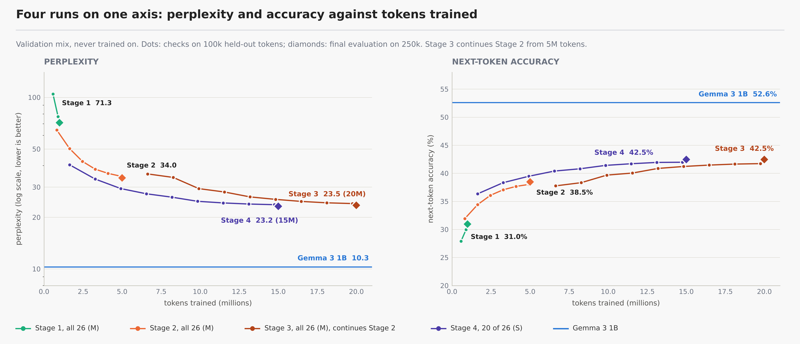

### Final evaluation (250k tokens per set)

| Set | Gemma ppl | Hybrid ppl, Stage 1 → 2 → 3 | Stage 3 ÷ Gemma | CE gap (nats), Stage 1 → 2 → 3 | Gap cut, Stage 2 → 3 | `GR_CE`, Stage 3 | Accuracy, Stage 3 (Gemma) |
| --- | --- | --- | --- | --- | --- | --- | --- |
| Validation mix | 10.25 | 71.28 → 33.96 → **23.50** | 2.29 | 1.94 → 1.20 → **0.83** | 31% | 0.937 | 42.5% (52.6%) |
| WikiText-103 | 11.84 | 144.57 → 71.18 → **48.34** | 4.08 | 2.50 → 1.79 → **1.41** | 22% | 0.892 | 33.1% (49.5%) |
| C4 validation | 16.19 | 129.13 → 71.57 → **51.32** | 3.17 | 2.08 → 1.49 → **1.15** | 22% | 0.906 | 31.4% (44.4%) |

### The power law

Four times the tokens cut the gap by 31% on the training mix but by only 22% on text unlike it. Through Stages 2 and 3:

$$
\Delta(T) = \mathrm{CE}_{\mathrm{hyb}}(T) - \mathrm{CE}_A \approx \Delta(T_2)\Big(\frac{T}{T_2}\Big)^{-\alpha}, \qquad
\alpha = \frac{\ln\big(\Delta(T_2)/\Delta(T_3)\big)}{\ln(T_3/T_2)}, \qquad
\alpha_{\mathrm{mix}} = 0.27,\ \ \alpha_{\mathrm{WikiText}} = \alpha_{\mathrm{C4}} = 0.18,\ \ \alpha_{\mathrm{fact}} = 0.41
$$

Each doubling of tokens removes $1 - 2^{-\alpha}$ of the gap: about 17% on the mix, 12% on WikiText-103 and C4, and 25% for the question test's fact log-probability (5.11 → 2.95 → 1.67 nats from Stage 1 to 3). At these rates the mix reaches 2 × Gemma's perplexity at about 40M tokens and 1.5 × at about 300M; C4 needs about 300M for 2 ×. Gemma-like quality by more tokens alone is out of reach on this Mac.

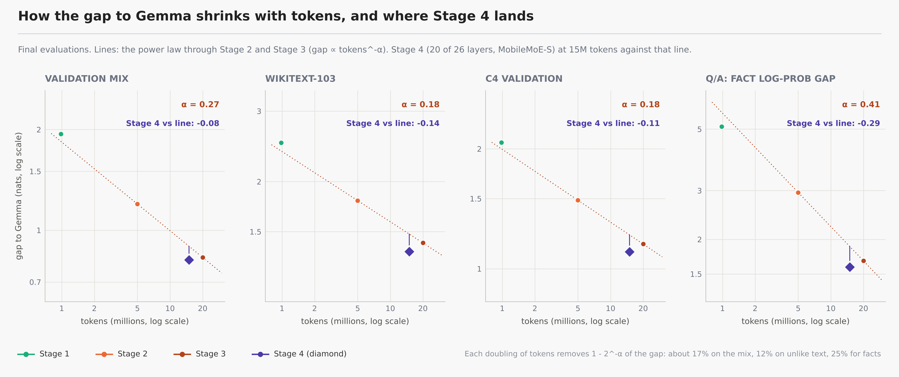

### Routing

| | Stage 1 | Stage 2 | Stage 3 |
| --- | --- | --- | --- |
| Mean normalized entropy | 0.940 | 0.959 | 0.961 |
| Lowest (layer) | 0.856 (2) | 0.829 (1) | 0.806 (1) |
| Dead experts (of 1,560) | 91 | 45 | 31 |
| Busiest expert's share (layer) | 8.3% (4) | 14.2% (1) | 15.6% (1) |

Healthy overall and improving, but layer 1 keeps narrowing, and 21 of the 31 dead experts sit in layers 0 to 3.

### Questions and answers

| Model | Correct | Fact log-prob | Fact recovery | Sentence log-prob | Copied |
| --- | --- | --- | --- | --- | --- |
| All 26 FFNs deleted | 0/30 | −14.81 | 0% | −12.91 | 0/30 |
| Stage 2 (5.0M) | 1/30 | −3.18 | 80% | −1.22 | 0/30 |
| **Stage 3 (20.0M)** | **6/30** | **−1.90** | **89%** | **−0.92** | 0/30 |
| Gemma 3 1B | 28/30 | −0.23 | 100% | −0.28 | 0/30 |

Right: Paris, Tokyo, Portuguese, Jupiter, gravity, blue. The fact became more likely than in Stage 2 for 29 of 30 questions (the exception: 2 + 2). Near misses stay in the right neighbourhood: the Congo for the Nile, 1939 for the end of World War II, George W. Bush for the first president, "the Apollo" for the first man on the Moon. Failure modes: "the United States" as an attractor (capital of Germany, pyramids of Giza), numbers (12 continents, 12 sides, 1,000 months, 2 + 2 = 2), and about 8 replies that echo the question. Free generation still loops ("The capital of France is the capital of the United States…"), though the question frame answers Paris. Every reply: [results/qa_compare.md](results/qa_compare.md).

### What Stage 3 showed

- **More tokens keep helping, slowly.** CE gap 0.83 nats on the mix (2.29 × Gemma's perplexity), 94% of the damage of deleting all FFNs repaired, accuracy at 81% of Gemma's, fact recovery 89%.
- **Unlike text recovers more slowly** ($\alpha = 0.18$ against 0.27), and facts faster ($\alpha = 0.41$).
- **Gemma-like quality is hundreds of millions of tokens away** on this recipe, weeks of laptop time.
- **Not answered:** whether MobileMoE's pretrained experts carry this, or any MoE with 61M trained projection parameters around it would do as well.

---

## 6. Stage 4: a different architecture (partial transplant with MobileMoE-S)

**Question:** does a partial transplant recover more of Gemma's quality per training token than replacing all 26 FFNs, and what does a much weaker donor change? Stage 4 keeps 6 of Gemma's own FFNs and puts the 20 MoE blocks of MobileMoE-S-Base into the other 20 layers, at the same relative depth. Full design and commands: [docs/stage4.md](docs/stage4.md); report: [results/stage4_compare.md](results/stage4_compare.md).

| | MobileMoE-M-Base (Stages 1-3) | MobileMoE-S-Base (Stage 4) |
| --- | --- | --- |
| Layers × width | 26 × 1024 | 20 × 768 |
| Experts per layer | 60 routed (FFN 512), top-4, + 1 shared (FFN 2048) | 60 routed (FFN 384), top-4, + 1 shared (FFN 1536) |
| Parameters, total / active | 2.8B / 528M | 1.3B / 272M |
| One MoE block / active per token | 100.7M / 12.6M | 56.7M / 7.1M |
| MMLU · TriviaQA · NQ, 5-shot (model cards) | 54.7 · 49.0 · 20.9 | 43.7 · 33.2 · 12.6 |
| Revision used | `f231740144b1` | `23b6f610d688` |

### 6.1 Architecture: layout `spread`

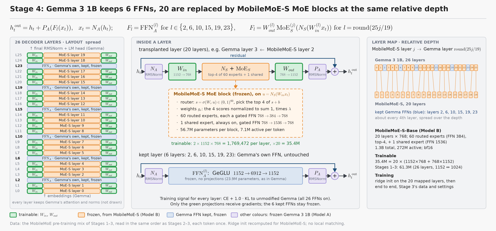

Every MobileMoE-S layer is used once, at its relative depth in Gemma; the Gemma layers no donor layer reaches keep their own FFN, frozen and without projections:

$$
l(j) = \mathrm{round}\Big(j \cdot \frac{L_A - 1}{L_B - 1}\Big) = \mathrm{round}\Big(\frac{25\,j}{19}\Big), \quad j = 0, \dots, 19, \qquad
\mathcal{K} = \{0, \dots, 25\} \setminus \{l(j)\} = \{2, 6, 10, 15, 19, 23\}
$$

Map: 0←0, 1←1, 3←2, 4←3, 5←4, 7←5, 8←6, 9←7, 11←8, 12←9, 13←10, 14←11, 16←12, 17←13, 18←14, 20←15, 21←16, 22←17, 24←18, 25←19 (Gemma layer ← MobileMoE-S layer). Each Gemma layer keeps its sandwich norms; the FFN slot holds either Gemma's own FFN or the transplant:

$$
h^{\mathrm{out}}_t = h_t + P_A\big(F_l(x_t)\big), \quad x_t = N_A(h_t), \qquad
F_l = \begin{cases} \mathrm{FFN}^{(l)}_A, & l \in \mathcal{K} \\ W^{(l)}_{out}\; \mathrm{MoE}^{(j)}_S\big(N_S(W^{(l)}_{in}\, x_t)\big), & l = l(j) \end{cases}
$$

with $W_{in}^{(l)} \in \mathbb{R}^{768 \times 1152}$ and $W_{out}^{(l)} \in \mathbb{R}^{1152 \times 768}$. MobileMoE-S's block has the same design as MobileMoE-M's:

$$
s = \sigma(W_r\, u) \in (0,1)^{60}, \qquad \mathcal{T} = \mathrm{TopK}(s + b,\ 4), \qquad g_e = \lambda\,\frac{s_e}{\sum_{e' \in \mathcal{T}} s_{e'}}, \qquad
\mathrm{MoE}_S(u) = S(u) + \sum_{e \in \mathcal{T}} g_e\, E_e(u), \quad u = N_S(W_{in}\, x_t)
$$

where $S$ is the always-on shared expert (768 → 1536 → 768), the $E_e$ are the 60 routed experts (768 → 384 → 768), $b$ is the fixed selection bias and $\lambda$ the routed scaling factor from MobileMoE-S's config.

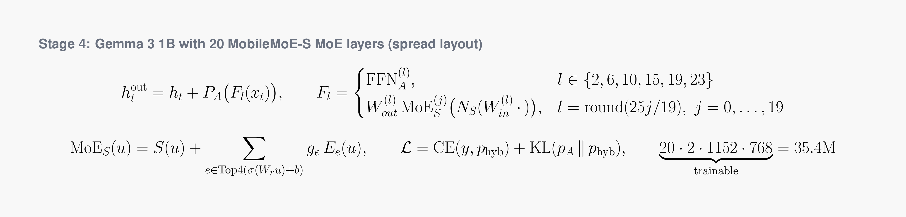

### 6.2 What it costs

| Quantity | Formula | Stage 4 | Stages 1-3 |
| --- | --- | --- | --- |
| Trainable | $20 \cdot 2 \cdot 1152 \cdot 768$ | **35,389,440** | 61,341,696 |
| MoE block, per layer (frozen) | $60 \cdot 3 \cdot 768 \cdot 384 + 3 \cdot 768 \cdot 1536 + 60 \cdot 768$ | 56.7M | 100.7M |
| MoE active per token, per layer | $4 \cdot 3 \cdot 768 \cdot 384 + 3 \cdot 768 \cdot 1536 + 60 \cdot 768$ | 7,123,968 | 12,644,352 |
| Active per token, whole hybrid | $378.8\mathrm{M} + 6 \cdot 23.9\mathrm{M} + 20 \cdot (7.12\mathrm{M} + 1.77\mathrm{M})$ | **about 0.70B** | about 0.77B (Gemma: 1.00B) |
| Weights in memory on the M5 | – | 4.11 GB | 6.97 GB |

### 6.3 Training

Data and recipe are those of Stages 2-3, so the runs compare token for token: the MobileMoE pre-training mix from the start of the stream, in the same order, each token once (the first 15M tokens Stages 2 and 3 read); ridge init recomputed for MobileMoE-S on the 20 layers (400 calibration documents, 211,601 aligned positions, `runs/stage4_spread_init/`); no local matching; then end to end with the unchanged objective, whose KL teacher is Gemma with all 26 FFNs:

$$
\mathcal{L} = \mathrm{CE}(y, p_{\mathrm{hyb}}) + \mathrm{KL}(p_A \Vert p_{\mathrm{hyb}})
$$

| Setting | Stage 4 |
| --- | --- |
| Config | `configs/base.yaml` + `configs/stages/stage4_spread_15m.yaml` (includes `configs/pairs/stage4_mobilemoe_s.yaml`); run folder `runs/stage4_spread_15m`; `bash scripts/stage4_run.sh 15m` |
| Tokens | 14,991,360 (915 steps of 16,384), one cosine schedule from 3e-4, 2% warmup |
| Speed check | micro-batch 1: 284 tok/s (6.83 GB); 2: 335 (7.88 GB); 4: 374 (8.00 GB); **8 × 2: 391 tok/s (10.23 GB, chosen)** |
| Speed, memory | about 50 s per step all run long, **326 tok/s** (1.8 × Stage 3); peak 11.6 GB of the 11.84 GB limit |
| Compute | ridge init about 8 minutes; about 13.3 hours of training for 15M tokens (Stage 3: about 23.5 hours for its 15M) |

### 6.4 Ridge init with two donors

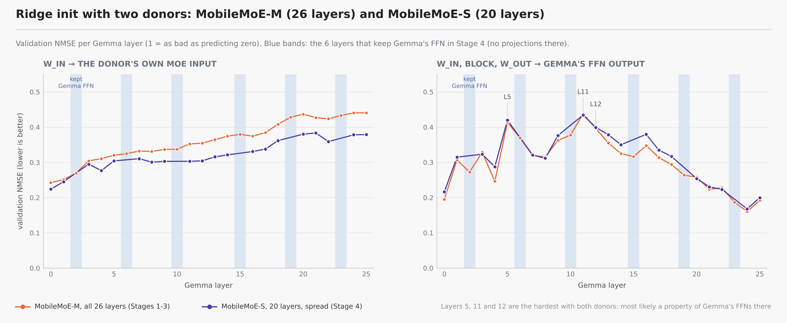

$W_{in}$ fits MobileMoE-S's own MoE inputs with validation NMSE 0.22 (layer 0) rising with depth to about 0.38 (layers 20-25), as with MobileMoE-M (0.24 → 0.44). Through the block and $W_{out}$, the hardest Gemma layers are 5, 11 and 12 (0.42, 0.43, 0.40), the same layers that were hardest with MobileMoE-M: most likely a property of Gemma's FFNs there rather than of the expert source (both donors share a family and training data, so not a proof).

### 6.5 Two floors

The layout floor (only the 20 transplanted FFNs deleted, the 6 kept) turns out to be **worse** than deleting all 26: the kept FFNs, fed a residual stream the deleted ones no longer shape, push the model further off course.

| Floor | Mix: ppl · CE gap | WikiText-103 | C4 |
| --- | --- | --- | --- |
| All 26 FFNs deleted (Stages 1-3) | 4.96M · 13.09 | 5.66M · 13.08 | 3.61M · 12.31 |
| Layout floor (20 deleted, 6 kept) | 913M · 18.31 | 2,819M · 19.29 | 942M · 17.88 |

$$
\mathrm{GR}_{\mathrm{CE}}^{(F)} = \frac{\mathrm{CE}_F - \mathrm{CE}_{\mathrm{hyb}}}{\mathrm{CE}_F - \mathrm{CE}_A}: \qquad
\mathrm{GR}_{\mathrm{CE}}^{(\text{26 deleted})} = 0.938, \qquad \mathrm{GR}_{\mathrm{CE}}^{(\text{layout})} = 0.955
$$

Recovery against the layout floor therefore overstates; every Stage 4 number in this README uses the all-26-deleted floor of Stages 1-3.

### 6.6 Results at matched tokens

| Tokens | All 26 (Stages 2 → 3) CE gap | Stage 4 CE gap | Stage 4 − all 26 | Stage 4 perplexity | Stage 4 accuracy | Stage 4 lowest routing entropy |
| --- | --- | --- | --- | --- | --- | --- |
| 1.64M | 1.603 | 1.386 | −0.22 | 40.43 | 36.3% | 0.846 |
| 3.28M | 1.327 | 1.194 | −0.13 | 33.38 | 38.3% | 0.811 |
| 4.92M | 1.232 | 1.067 | −0.17 | 29.39 | 39.5% | 0.789 |
| 6.55M | 1.262 | 0.997 | −0.27 | 27.40 | 40.4% | 0.760 |
| 8.19M | 1.218 | 0.951 | −0.27 | 26.18 | 40.8% | 0.753 |
| 9.83M | 1.073 | 0.896 | −0.18 | 24.77 | 41.4% | 0.737 |
| 11.47M | 1.023 | 0.874 | −0.15 | 24.24 | 41.7% | 0.727 |
| 13.11M | 0.958 | 0.859 | −0.10 | 23.88 | 41.9% | 0.721 |
| 14.75M | 0.923 | 0.851 | −0.07 | 23.67 | 42.0% | 0.714 |

Checks on 100k held-out tokens of the validation mix; the all-26 values at Stage 4's checks after 5M are interpolated between Stage 3's. Stage 4 is ahead at every check, by less late in training; part of the gap at 6.6-8.2M is Stage 3's learning-rate warm-up.

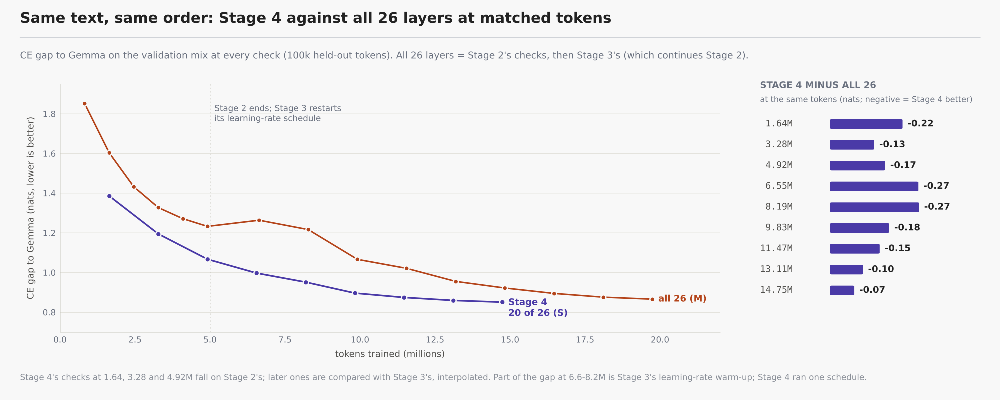

### 6.7 Final evaluation (250k tokens per set)

| Set | Gemma ppl | Stage 3 ppl (20M, all 26, M) | **Stage 4 ppl (15M, 20 of 26, S)** | CE gap S3 / **S4** | All 26 at 15M (power law) | S4 − all 26 at 15M | Accuracy S3 / **S4** (Gemma) |
| --- | --- | --- | --- | --- | --- | --- | --- |
| Validation mix | 10.25 | 23.50 | **23.17** | 0.829 / **0.815** | 0.90 | −0.08 | 42.5% / **42.5%** (52.6%) |
| WikiText-103 | 11.84 | 48.34 | **45.14** | 1.406 / **1.338** | 1.48 | −0.14 | 33.1% / **33.0%** (49.5%) |
| C4 validation | 16.19 | 51.32 | **48.77** | 1.154 / **1.103** | 1.22 | −0.11 | 31.4% / **31.7%** (44.4%) |

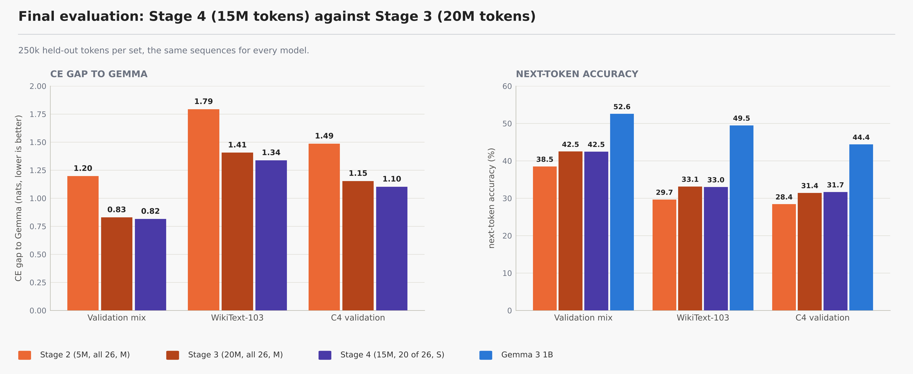

Stage 4 at 15M tokens equals or slightly beats Stage 3 at 20M on every set, with 25% fewer tokens, 42% fewer trained parameters and a donor 11 MMLU points weaker. Against the all-26 power law read off at 15M tokens, the gain is largest on text unlike the training mix (−0.14 nats on WikiText-103, −0.11 on C4, −0.08 on the mix).

### 6.8 Questions and answers

| Model | Correct | Fact log-prob | Fact recovery (26 deleted = 0%) | Sentence log-prob |
| --- | --- | --- | --- | --- |
| Layout floor (20 deleted, 6 kept) | 0/30 | −20.16 | −37% | −16.46 |
| Stage 3 (20M) | 6/30 | −1.90 | 89% | −0.92 |
| **Stage 4 (15M)** | **10/30** | **−1.82** | **89%** | **−0.83** |
| Gemma 3 1B | 28/30 | −0.23 | 100% | −0.28 |

Right: Paris, Portuguese, the Nile, the Sun, the heart, gravity (an echo of the question), 12 months, blue, Shakespeare, 1945; Stage 3's Tokyo and Jupiter were missed. Question by question, the fact got more likely than in Stage 3 for 16, less likely for 12 and stayed within 0.05 for 2: about the same recall from a much weaker donor (10 against 6 correct is within the noise of 30 questions). Failure modes are unchanged: "the United States" attractor, numbers (2 + 2 = 2, four sides, 12 days in a week), echoes. Free generation still loops ("The capital of France is 100000000…"). Every reply: `runs/stage4_spread_15m/qa.md`.

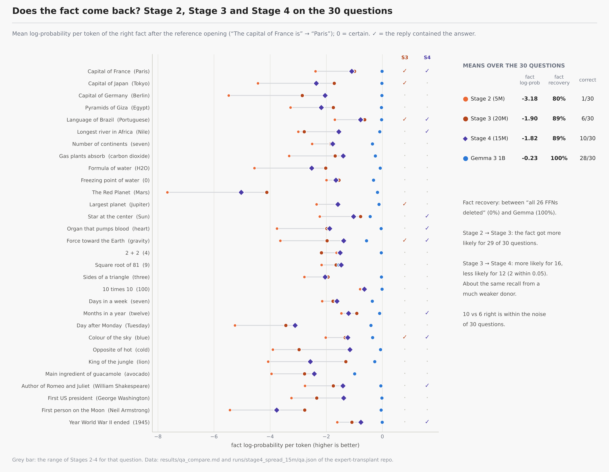

### 6.9 Routing

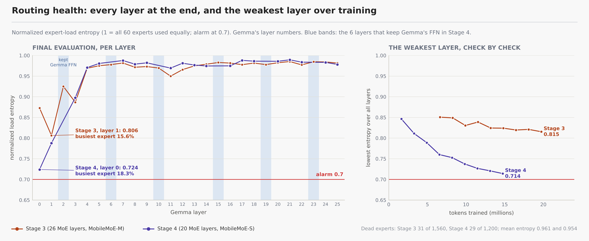

Mean normalized entropy 0.954 over the 20 MoE layers; 29 of 1,200 experts dead (2.4%; Stage 3: 2.0%), 26 of them in the first three MoE layers (Gemma layers 0, 1, 3). Gemma layer 0 (MobileMoE-S layer 0) ends at 0.724 with its busiest expert taking 18.3% of the routing slots, and the lowest entropy fell at every check (0.846 → 0.714), toward the 0.7 alarm. As in Stages 1-3, the early MoE layers concentrate. A likely reason, not tested: early MoE layers route mostly on token identity, learned on the Llama 3 tokenizer, which Gemma's tokens and a linear $W_{in}$ cannot reproduce.

### What Stage 4 showed

- **The partial transplant works at least as well as replacing all 26 FFNs**, per token and per parameter, and trains 1.8 × faster on the Mac. Keeping 6 of Gemma's FFNs spread over the depth helps most on unlike text.
- **A much weaker donor gives the same text quality and the same factual recall.** That fits the reading that the recovered quality and facts do not come mainly from the transplanted experts' own knowledge (Gemma's attention, its 6 kept FFNs and the trained projections carrying most of it), but the 6 kept FFNs could also be making up for the weaker donor, and fact recall rests on 30 questions.
- **Confound:** Stage 4 changes the layout, the donor and the number of trained parameters at once. No control that separates them was run.
- **Early-layer routing is the weak spot**, with both donors.

---

## Run it

Needs [uv](https://docs.astral.sh/uv/) and access to the gated models on Hugging Face (accept Google's Gemma terms; request access to MobileMoE-M-Base and, for Stage 4, MobileMoE-S-Base, which is gated separately), then `uv run hf auth login`.

```bash
bash scripts/setup.sh                                                       # uv sync, MPS check, unit tests, tiny end-to-end run
bash scripts/m0_checks.sh                                                   # downloads, module names, data check, held-out sets, 7 gating tests
bash scripts/stage1_test_run.sh                                             # Stage 1: 1M tokens, about 3 hours on the M5
bash scripts/stage2_full_run.sh --config configs/stages/stage2_5m.yaml      # Stage 2 as run: 5M tokens end to end, about 12 hours
bash scripts/stage3_run.sh                                                  # Stage 3: +15M tokens on Stage 2 (20M in total), speed check first
bash scripts/stage4_test.sh                                                 # Stage 4: gating tests on the MobileMoE-S pair
bash scripts/stage4_run.sh 15m                                              # Stage 4: spread layout, 15M tokens from ridge init, about 14 hours
bash scripts/stage4_validate.sh runs/stage4_spread_15m --agreement          # re-evaluation, Q/A and routing agreement for a Stage 4 run
bash scripts/ask_stages.sh                                                  # Q/A test for every stage -> results/qa_compare.md
uv run python -m transplant summarize                                       # one line per run and set from results/runs.csv
```

The full guide (data mix and sources, hardware and memory budget, every script and command, checkpointing and resuming, what a run writes, the tests): **[docs/usage.md](docs/usage.md)**. Stage 4's run, configs and report: **[docs/stage4.md](docs/stage4.md)**.

### Repository layout

```
expert-transplant/
├── README.md
├── LICENSE, THIRD_PARTY_LICENSES.md
├── pyproject.toml, uv.lock, .python-version   # uv; Python 3.12, torch 2.8.0, transformers 4.57.6
├── configs/
│   ├── base.yaml                               # every default, commented
│   ├── stages/       stage1_test.yaml, stage2_full.yaml, stage2_5m.yaml, stage3_20m.yaml,
│   │                 stage4_spread_15m.yaml, stage4a_spread_1m.yaml, stage4b_spread_5m.yaml, stage4c_spread_20m.yaml
│   ├── pairs/        primary.yaml (Gemma + MobileMoE-M, all 26 layers), stage4_mobilemoe_s.yaml (MobileMoE-S, spread), tiny.yaml
│   ├── data/         mobilemoe_pretrain_mix.yaml (Table B.1)
│   └── hardware/     mac_m5.yaml (MPS, bf16)
├── src/transplant/
│   ├── models/   load.py, moe_source.py, surgery.py, projection.py, layer_map.py (incl. spread), align.py, capture.py, tiny.py
│   ├── data/     sources.py, mixture.py, pack.py, heldout.py
│   ├── init/     ridge.py
│   ├── train/    local_match.py, end_to_end.py, losses.py, optim.py, checkpoint.py, interrupt.py, run.py
│   ├── eval/     perplexity.py, metrics.py, routing.py, cka.py, samples.py, ask.py, baselines.py, evaluate.py
│   ├── utils/    device.py, memory.py, logging.py, progress.py, seed.py
│   ├── tools.py  # M0 checks
│   └── cli.py    # python -m transplant <command>
├── scripts/      setup.sh, m0_checks.sh, stage1_test_run.sh, stage2_full_run.sh, stage2_extend.sh, stage3_run.sh,
│                 stage3_speed.py, stage4_test.sh, stage4_run.sh, stage4_validate.sh, stage4_compare.py,
│                 ask_stages.sh, progress.py, env.sh
├── tests/
├── docs/         architecture.md, usage.md, stage4.md, figures/ (4 architecture figures, 13 equation cards,
│                 stage4/ architecture and equations, results/ charts of Stages 1-4)
├── notes/        local run logs (git-ignored)
└── results/      runs.csv, qa_compare.md, stage4_compare.md
```

## Licenses

Code: Apache 2.0 (`LICENSE`). Models and datasets keep their own terms; `THIRD_PARTY_LICENSES.md` summarizes those of Stages 1-3: MobileMoE-M-Base is non-commercial research only, Gemma has its own terms, and Natural Reasoning is CC-BY-NC-4.0. MobileMoE-S-Base, used in Stage 4 and not listed there, is gated separately under the same FAIR Noncommercial Research License. Trained projections are derived from Gemma and the MobileMoE model they were trained with; share them only as those licenses allow. The charts in `docs/figures/results/` are drawn from the run files of Stages 1 to 4; `docs/figures/stage4/` comes from `docs/figures/src/make_stage4_figures.py`.

---

> **Note.** Due to hardware constraints (one MacBook Air with 16 GB of memory), I have stopped this experiment at this stage for now. If you try it, with this pair of models or another, let me know your results.
