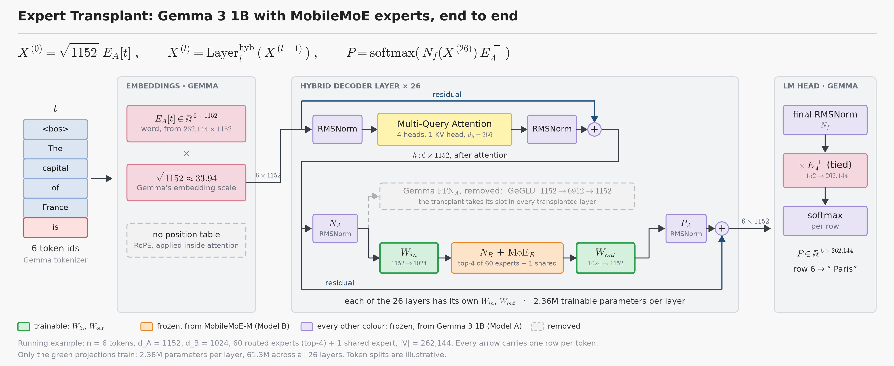
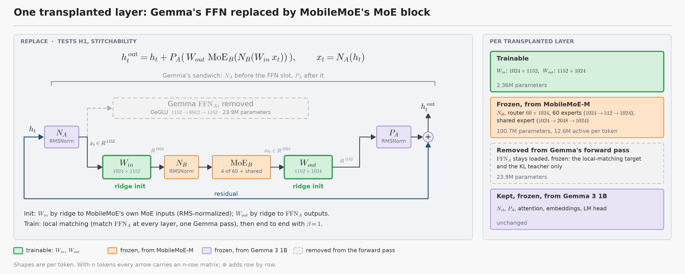
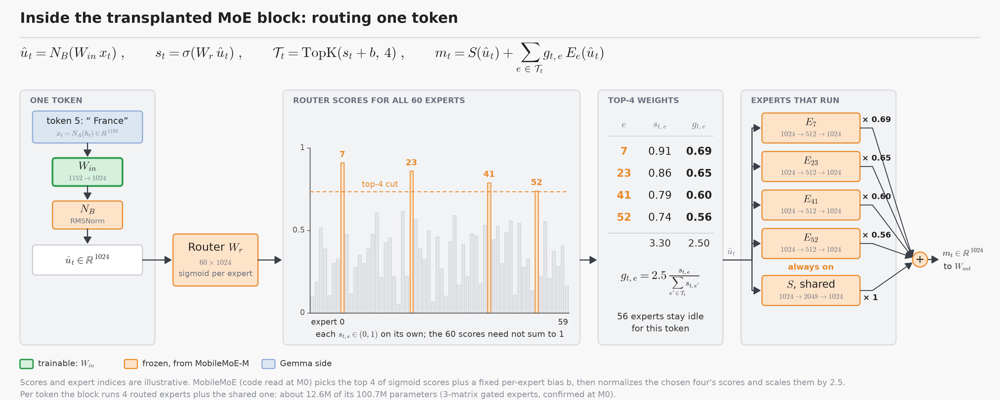
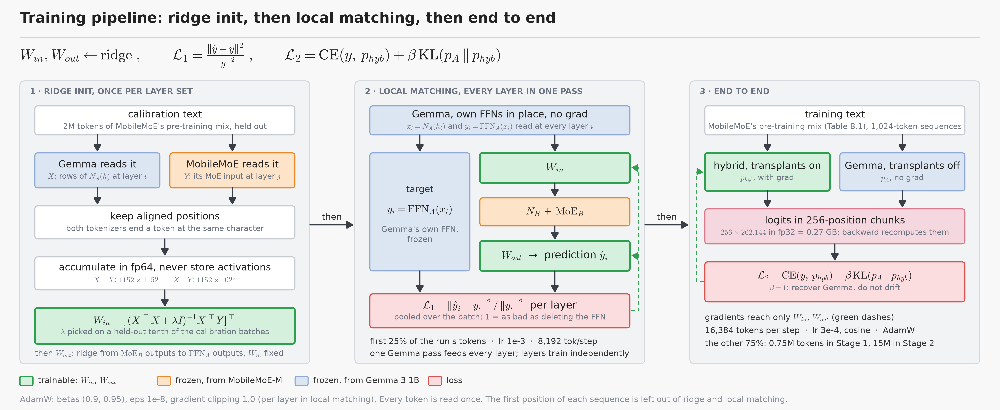

# Architecture and math

Gemma 3 1B with its FFNs replaced by MobileMoE-M's MoE blocks. Colour code in every figure: green is trainable, orange is frozen MobileMoE-M (Model B), every other colour is frozen Gemma 3 1B (Model A), grey dashed is removed. The equation cards in `figures/equations/` (PNG, 4,000 px wide, LaTeX sources in `figures/src/equations/`) carry the same equations for slides and articles; rebuild everything with `python docs/figures/src/make_figures.py` and `python docs/figures/src/make_equation_cards.py`.

| Symbol | Meaning | Primary pair |
| --- | --- | --- |
| d_A, d_B | Widths of Gemma and MobileMoE | 1152, 1024 |
| h | Gemma's residual stream after attention, one row per token | n × 1152 |
| x = N_A(h) | Input to the FFN slot, after Gemma's pre-FFN norm | n × 1152 |
| W_in, W_out | The trainable projections | 1024 × 1152 and 1152 × 1024 |
| N_B, MoE_B | MobileMoE's frozen pre-MoE norm and MoE block | 60 routed experts (top-4) plus 1 shared expert |
| P_A | Gemma's frozen post-FFN norm | one per layer |
| V | Gemma's vocabulary | 262,144 tokens |

## End to end

$$
X^{(0)} = \sqrt{1152}\,E_A[t], \qquad X^{(l)} = \mathrm{Layer}^{\mathrm{hyb}}_l\big(X^{(l-1)}\big), \qquad P = \mathrm{softmax}\big(N_f(X^{(26)})\,E_A^{\top}\big)
$$

Embeddings, attention, norms and the LM head stay Gemma's and stay frozen. MobileMoE contributes only its pre-MoE norms, routers and experts. Every arrow outside the FFN slot carries a Gemma-shaped tensor.

## One transplanted layer

Gemma wraps each sub-block in a norm on both sides (card `eq01_gemma_layer`):

$$
h = X + P_{\mathrm{att}}\big(\mathrm{Attn}(N_{\mathrm{in}}(X))\big), \qquad X' = h + P_A\big(\mathrm{FFN}_A(N_A(h))\big)
$$

The transplant takes the FFN slot (card `eq02_replace`):

$$
h^{\mathrm{out}}_t = h_t + P_A\Big(W_{out}\;\mathrm{MoE}_B\big(N_B(W_{in}\,x_t)\big)\Big), \qquad x_t = N_A(h_t) \in \mathbb{R}^{1152}
$$

Read it right to left: translate Gemma's state into MobileMoE's coordinates, let MobileMoE's norm and experts work there, translate back. H1 asks whether that round trip can stand in for the 23.9M-parameter FFN Gemma was trained with. In code this is `ReplaceFFN` in `src/transplant/models/surgery.py`; it sits at `layer.mlp`, so Gemma's own `pre_feedforward_layernorm` (N_A) and `post_feedforward_layernorm` (P_A) are untouched.

## The MoE block and its router

Cards `eq03_router` and `eq04_moe_output`:

$$
\hat u_t = N_B(u_t), \qquad s_t = \sigma(W_r\,\hat u_t) \in (0,1)^{60}, \qquad \mathcal{T}_t = \mathrm{TopK}(s_t + b, 4), \qquad g_{t,e} = 2.5\,\frac{s_{t,e}}{\sum_{e' \in \mathcal{T}_t} s_{t,e'}}
$$

$$
m_t = S(\hat u_t) + \sum_{e \in \mathcal{T}_t} g_{t,e}\,E_e(\hat u_t)
$$

In MobileMoE's code (read at M0) each of the 60 experts runs on exactly the tokens routed to it, with no capacity limit, so routing is dropless; b is a fixed per-expert bias that shifts which experts are selected but not their weights, and the chosen four's weights sum to 2.5 (MobileMoE's routed scaling factor). The block computes its router logits itself in fp32 and returns its output flattened to (tokens, 1024); the wrapper restores the shape and reads the logits from the block's output for the routing diagnostics. On the Apple GPU the repo runs the same arithmetic through `bucketed_moe_forward`: the token groups of the experts are padded to a few fixed sizes, so the GPU sees few tensor shapes and waits for the host once per layer instead of once per expert.

The router is frozen, so W_in alone decides which 4 of the 60 experts each token reaches. If W_in squeezes many tokens into one region of MobileMoE's space, the same few experts fire for all of them; the routing-health metrics watch for this.

## Projections, and why only direction matters

Cards `eq05_projection` and `eq06_rmsnorm_scale`:

$$
u_t = W_{in}\,x_t, \qquad N(z) = \frac{z}{\sqrt{\frac{1}{d}\sum_c z_c^2 + \epsilon}} \odot \gamma, \qquad N_B(\alpha W_{in}x_t) \approx N_B(W_{in}x_t), \quad P_A(\alpha W_{out}m_t) \approx P_A(W_{out}m_t)
$$

An RMSNorm sits right after each projection (N_B after W_in, P_A after W_out), so only the direction of what each projection produces reaches the next stage. The local-matching MSE also penalises length errors that P_A discards; `local.loss: nmse_post_norm` compares P_A(ŷ) with P_A(y) instead.

Layers pair by relative depth (card `eq07_layer_map`): j = round(i · (L_B − 1)/(L_A − 1)), which is j = i for the primary pair.

## Initialization: ridge regression

Card `eq08_ridge`:

$$
\hat W = (X^{\top}X + \lambda I)^{-1}X^{\top}Y, \qquad W_{in} = \hat W^{\top}
$$

Rows of X are Gemma's N_A(h); rows of Y are MobileMoE's MoE-block inputs on the same text, RMS-normalized per token (N_B discards scale, and this keeps a few huge-norm tokens from dominating). Only positions where both tokenizers end a token at the same character are paired, and the first position of each sequence is left out. X^T X and X^T Y are accumulated in fp64 (about 20 MB per layer) instead of storing 9 GB of activations. λ is picked per layer on a held-out tenth of the calibration batches. W_out is then fitted by ridge from MoE_B(N_B(W_in x)) to Gemma's own FFN_A(x); both sides come from Gemma's forward pass.

## Training: local matching, then end to end

Every run spends its first 25% of tokens on local matching and the other 75% end to end; each token is read once. Local matching (card `eq09_local_matching`), normalized MSE pooled over the batch:

$$
\mathcal{L}_1 = \frac{\sum_t \Vert \hat y_t - y_t\Vert^2}{\sum_t \Vert y_t\Vert^2}, \qquad \hat y_t = W_{out}\,\mathrm{MoE}_B\big(N_B(W_{in}x_t)\big), \qquad y_t = \mathrm{FFN}_A(x_t)
$$

Predicting zero, which is what the ablated layer does, scores exactly 1. One Gemma forward pass (its own FFNs in place, no gradient) supplies x_i and y_i for all 26 layers at once; layers then train independently, each with its own gradient clipping.

End to end (card `eq10_end_to_end`):

$$
\mathcal{L}_2 = \mathrm{CE}(y, p_{hyb}) + \beta\,\mathrm{KL}(p_A \Vert p_{hyb}), \qquad \beta = 1
$$

β = 1 because the goal is recovery: drifting away from Gemma counts as error. p_A comes from a no-grad pass of the same model with the transplants switched off. Both terms are computed 256 positions at a time: logits for 1,024 tokens would take 1.07 GB in fp32, a chunk takes 0.27 GB. The backward pass is written by hand (`_FusedCEKL` in `src/transplant/train/losses.py`): it recomputes the chunk's logits and turns them into the gradient in place, dL/dz = (g_CE + g_KL) softmax(z) − g_CE onehot(y) − g_KL p_A, so at most two fp32 logit buffers are alive at once.

| Setting | Local matching | End to end |
| --- | --- | --- |
| Optimizer | AdamW, betas (0.9, 0.95), eps 1e-8 | same |
| Learning rate, schedule | 1e-3, constant after warmup (100 steps, at most 10% of the phase) | 3e-4, cosine to 10%, 2% warmup |
| Weight decay | 0 | 0.01 |
| Clipping | 1.0 per layer | 1.0 global |
| Tokens per step | 8,192 (micro-batch 2 × 1,024, 4 accumulation steps) | 16,384 (micro-batch 1 × 1,024, 16 accumulation steps) |
| Stage 1 test run, 1M tokens | 0.25M tokens, 30 steps | 0.75M tokens, 45 steps |
| Stage 2 full run, 20M tokens | 5M tokens, 610 steps | 15M tokens, 915 steps |
| Each Stage 2 extension | none | all added tokens, fresh AdamW state and cosine schedule |

Steps round down, so a run never reads more than its budget. An extension starts from the finished run's projections and continues its data stream where it stopped, so no token is read twice.

## Metrics

Card `eq11_gap_recovery`:

$$
\mathrm{GR} = \frac{\mathrm{ppl}_{\mathrm{ablated}} - \mathrm{ppl}_{\mathrm{hybrid}}}{\mathrm{ppl}_{\mathrm{ablated}} - \mathrm{ppl}_{A}}, \qquad
\mathrm{GR}_{\mathrm{CE}} = \frac{\mathrm{CE}_{\mathrm{ablated}} - \mathrm{CE}_{\mathrm{hybrid}}}{\mathrm{CE}_{\mathrm{ablated}} - \mathrm{CE}_{A}}
$$

GR runs from "FFN deleted" (0) to "Gemma intact" (1). With all 26 FFNs removed the ablated perplexity explodes and GR saturates near 1 even for a poor hybrid, so GR_CE (the same ratio in loss space) is the headline number for the all-26 hybrid, with ppl_hybrid / ppl_A and the gap ppl_ablated − ppl_A beside it. Next-token accuracy, the share of positions where the hybrid's most likely token is the right one, is reported for Gemma, the ablated model and the hybrid on the same positions.

Card `eq12_routing_health`:

$$
\tilde H = -\frac{1}{\log 60}\sum_{e} f_e \log f_e \ge 0.7, \qquad J_t = \frac{\lvert \mathcal{T}^{\mathrm{hyb}}_t \cap \mathcal{T}^{B}_t\rvert}{\lvert \mathcal{T}^{\mathrm{hyb}}_t \cup \mathcal{T}^{B}_t\rvert}, \qquad \mathbb{E}[J]_{\mathrm{chance}} \approx 0.039
$$

f_e is expert e's share of all top-4 assignments in a layer; e^H is the effective number of experts in use (the 0.7 alarm means fewer than about 18). J compares the hybrid's top-4 with MobileMoE's own top-4 on aligned positions. CKA between W_in N_A(h) and MobileMoE's own MoE input (both RMS-normalized) measures how well W_in reproduces MobileMoE's coordinates.

## Counting parameters

Card `eq13_parameter_count`:

| Quantity | Formula | Value |
| --- | --- | --- |
| Trainable, per layer | 2 · 1152 · 1024 | 2,359,296 |
| Trainable, all 26 layers | × 26 | 61,341,696 |
| MoE block, per layer (frozen) | 60 · 3 · 1024 · 512 + 3 · 1024 · 2048 + 60 · 1024 | 100,724,736 |
| MoE active per token, per layer | 4 routed + shared + router | 12,644,352 |
| Gemma FFN, per layer (removed from the forward pass) | 3 · 1152 · 6912 | 23,887,872 |
| Active per token, change per transplanted layer | 12,644,352 + 2,359,296 − 23,887,872 | −8,884,224 |
| Active per token, all 26 replaced | 999,885,952 − 26 · 8,884,224 | about 769M (Gemma: 1.00B) |
| Projections with AdamW moments, fp32 | 61.3M × 16 bytes | 0.98 GB |
| MoE blocks, bf16 | 2.62B × 2 bytes | 5.24 GB |

Expert sizes assume gated experts with three matrices each, which matches about 101M per layer; `python -m transplant inspect` confirms it at M0 (plan assumption A3).
